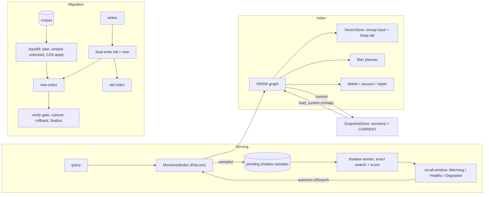
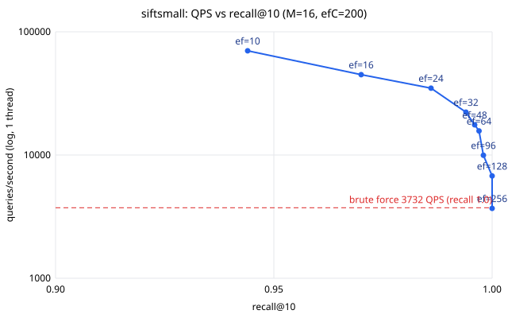

# hnswops

An HNSW approximate-nearest-neighbor index written from scratch in Rust, plus
the operational tooling that a vector-search service needs around the index:

- **Index**: insert/upsert, delete with tombstones + local repair, vacuum,
  filtered search with a cost-based planner, configurable `M` /
  `efConstruction` / `efSearch`, L2 / cosine / inner product.
- **Persistence**: checksummed on-disk images whose vectors are
  **memory-mapped** at load, so start-up does not read every vector.
- **Versioned snapshots**: atomic publish, `CURRENT` pointer, verified
  rollback, retention.
- **Online recall monitoring**: a sampled share of live queries is replayed
  as brute-force *shadow queries*. The results feed a sliding-window recall
  estimate with alerting and `efSearch` autotuning.
- **Zero-downtime re-embedding migration**: dual-write, a resumable backfill
  that cannot overwrite newer writes, a verification gate, cutover and
  lossless rollback, including a change of vector dimension.

It is meant for engineers who run or evaluate vector search and want to see
the full lifecycle of an ANN index in one readable codebase: how it is built,
how it degrades and how it is repaired, measured and migrated. It is a
portfolio and learning project, not a production database (see
[Limitations](#limitations)).

## Architecture



| module | what it does |
|---|---|
| `src/hnsw/` | graph, insert/search (paper Algorithms 1, 2, 4, 5), delete/vacuum/health, filters and planner |
| `src/storage.rs`, `src/persist.rs` | mmap-able vector file, index image format, validation on load |
| `src/snapshot.rs` | versioned snapshot store |
| `src/monitor.rs` | recall monitor, `MonitoredIndex`, autotune |
| `src/embed.rs`, `src/migration.rs` | `Embedder`/`Corpus` traits, re-embedding state machine |
| `src/dataset.rs`, `src/brute.rs`, `src/bench.rs` | `.fvecs`/`.ivecs` with pinned checksums, exact k-NN, recall/QPS sweep |
| `src/main.rs`, `src/cli.rs`, `src/demo.rs` | `hnswops` CLI and the offline demo |

[`docs/ARCHITECTURE.md`](docs/ARCHITECTURE.md) covers the algorithms, file
formats, the argument for why the migration is race-free, and the cost of
every operation.

## Quickstart

Requires a stable Rust toolchain (1.82 or newer). `make check` also needs
`cargo-llvm-cov` and the `llvm-tools` component.

```sh
make check          # fmt + clippy -D warnings + rustdoc + doc examples + all tests under coverage (gate: 80% lines)
make demo           # offline end-to-end demo on the committed fixture
make fetch-data     # optional: download SIFT10K (5.3 MB) and verify its checksums
make bench          # recall/QPS curves -> bench/results/{fixture,siftsmall}.{json,md,svg}
```

CLI:

```sh
cargo run --release -- build  --store /tmp/idx --m 16 --ef-construction 200      # build fixture index, commit v1
cargo run --release -- eval   --store /tmp/idx --k 10 --ef 64                     # recall vs ground truth (mmap'd load)
cargo run --release -- search --store /tmp/idx --query 3 --k 5 --filter 'tags_any=0x100'
cargo run --release -- snapshot --store /tmp/idx list | verify 1 | rollback 1 | prune --keep 3
cargo run --release -- health --store /tmp/idx
```

Library:

```rust
use hnswops::{Filter, Hnsw, HnswConfig, SearchParams};

let mut index = Hnsw::new(HnswConfig::new(128).with_m(16).with_ef_construction(200))?;
index.insert_with_tags(42, &vector, 0b01)?;
let hits = index.search_with(&query, SearchParams::top(10).ef(64).filter(&Filter::TagsAny(0b01)))?;
index.delete(42)?;
index.vacuum();
```

## Demo output

Output of `make demo` from a real run (macOS/arm64, release build, on a
machine shared with other build jobs). Timings vary from run to run. The
migration counters in step 8 also vary, because a reader and a writer thread
really do race the backfill.

```text
== 1. dataset ==
fixture: 10000 base x 32d, 200 held-out queries, exact top-100 ground truth (sha256 verified)

== 2. build (M=16, efConstruction=200) ==
inserted 10000 points in 0.52s; max level 3, level histogram [10000, 638, 35, 4], mean layer-0 degree 15.3
health: every live node reachable from the entry point on layer 0

== 3. recall@10 vs ground truth (held-out queries) ==
efSearch=10   recall@10=0.9115  (5 µs/query incl. scoring)
efSearch=16   recall@10=0.9620  (7 µs/query incl. scoring)
efSearch=32   recall@10=0.9970  (18 µs/query incl. scoring)
efSearch=64   recall@10=1.0000  (18 µs/query incl. scoring)
efSearch=128  recall@10=1.0000  (29 µs/query incl. scoring)

== 4. filtered search (cost-based planner) ==
tenant 3 (~12.5%)        selectivity≈0.125 est.cost graph=8192   scan=1565   -> BruteForce ef_used=0 dist_evals=1250 recall=1.00
flagged (~2%)            selectivity≈0.021 est.cost graph=49072  scan=521    -> BruteForce ef_used=0 dist_evals=200 recall=1.00
tenant 3 AND key<5000    selectivity≈0.063 est.cost graph=16368  scan=939    -> BruteForce ef_used=0 dist_evals=625 recall=1.00
NOT flagged (~98%)       selectivity≈0.979 est.cost graph=1056   scan=10104  -> FilteredGraph ef_used=66 dist_evals=464 recall=1.00

== 5. delete 30% (tombstones + local repair), then vacuum ==
deleted 3000 keys in 0.09s; live=7000 tombstones=3000
before vacuum: dangling edges=9537 unreachable(l0)=0 deleted keys returned=0 recall@10(ef=64, vs live exact)=1.0000 (was 1.0000)
vacuum in 0.38s: removed=3000 lists repaired=4697 reconnected=1 -> dangling=0 unreachable=0 recall@10=0.9995
re-inserted the 3000 keys: live=10000 recall@10 vs original ground truth=0.9995

== 6. versioned snapshots (atomic publish, mmap'd load, rollback) ==
committed v1 (10000 live, 2130418 bytes) and v2 (9750 live); CURRENT=v2
loaded CURRENT in 1.9 ms with 10000 vectors memory-mapped; results identical to in-memory index: true
rollback -> CURRENT=v1, live=10000 (checksums verified), versions=[1, 2]

== 7. online recall monitoring (sampled brute-force shadow queries) ==
2026-10-25T11:48:36.869331Z  WARN hnswops::monitor: recall degraded mean_recall=0.93125 target=0.97
step 0: efSearch=10   status=Degraded window=100 mean=0.9160 p10=0.80 alerts=1 dropped=0
        autotune: efSearch 10 -> 20
step 1: efSearch=20   status=Healthy window=96 mean=0.9708 p10=0.90 alerts=1 dropped=0

== 8. zero-downtime re-embedding migration (hash-v1 64d -> hash-v2 128d) ==
old index: 4000 docs, snapshot v1 labelled "pre-migration hash-v1"
backfill: 33 batches in 0.29s while serving 1540 reads (0 failed) and 200 dual-writes/50 dual-deletes
backfilled=3960 skipped(stale CAS)=9 skipped(already dual-written)=200 phase=Backfilled
verify: corpus=4150 new_live=4150 missing=0 extra=0 new-index recall@10=0.9917 old/new top-10 overlap=0.25 passed=true
query "t4w4 t4w0 t4w13 t4w1 t4w2": old model top-5 [2814, 1693, 2259, 1351, 1858] -> new model top-5 [2902, 1654, 2981, 773, 66]
2026-10-25T11:48:37.362869Z  WARN hnswops::migration: reads rolled back to old index to="hash-v1"
rollback: reads back on hash-v1 (lossless; writes kept flowing to both)
finalized: new index 4150 docs x 128d, snapshot v2 labelled "post-migration hash-v2"

demo complete; artifacts in demo-out
```

How to read it: step 5 shows that tombstones keep the graph routable (no
deleted key is ever returned, recall stays at 1.0). Vacuum then removes 9,537
dangling edges and re-links one orphaned node. In step 7, `efSearch=10`
misses the 0.97 target, so the monitor raises an alert and autotune doubles
`ef` until the window is healthy again. In step 8, 1,540 reads were served
during the backfill with none failing, the compare-and-set skipped 9 rows
that racing writes had made stale, and the gate confirms full coverage before
cutover.

## Benchmarks and evaluations

Every number below was produced by a committed command. Raw results are in
`bench/results/*.json`, the tables in `*.md` and the curves in `*.svg`.

### Recall/QPS on SIFT10K (public, held-out queries)

`make bench-sift` (= `hnswops bench --dataset siftsmall --data data/siftsmall --m 16 --ef-construction 200 --k 10 --out bench/results/siftsmall`).
The data is fetched and checksum-verified by `make fetch-data` (see [DATA.md](DATA.md)).

n=10,000, d=128, 100 queries, recall@10. Build: 1.23 s (8,136 inserts/s). The brute-force baseline is 3,732 QPS on one thread.

| efSearch | recall@10 | min recall | QPS (1 thread) | speed-up vs brute | p50 µs | p99 µs | dist evals/query |
|---:|---:|---:|---:|---:|---:|---:|---:|
| 10 | 0.9440 | 0.70 | 70121 | 18.8x | 12.4 | 46.5 | 206 |
| 16 | 0.9700 | 0.70 | 44881 | 12.0x | 18.3 | 98.1 | 263 |
| 24 | 0.9860 | 0.70 | 34878 | 9.3x | 26.5 | 87.0 | 342 |
| 32 | 0.9940 | 0.80 | 22262 | 6.0x | 37.2 | 190.6 | 415 |
| 48 | 0.9960 | 0.80 | 17576 | 4.7x | 50.1 | 196.5 | 547 |
| 64 | 0.9970 | 0.80 | 15681 | 4.2x | 60.3 | 156.2 | 665 |
| 96 | 0.9980 | 0.80 | 9955 | 2.7x | 83.3 | 355.1 | 867 |
| 128 | 1.0000 | 1.00 | 6771 | 1.8x | 112.3 | 916.5 | 1043 |
| 256 | 1.0000 | 1.00 | 3690 | 1.0x | 191.5 | 1653.7 | 1595 |



**Caveat on the timing columns.** These runs were made while the 8-core
machine was shared with other compile jobs (load average around 15), so QPS
and latency are noisy and too low in absolute terms. Compare the rows with
each other rather than with published numbers. The recall and
distance-evaluations columns do not depend on load and are reproducible.
SIFT10K is small (10k points), so brute force is still cheap there, and the
speed-up over a scan grows with `n`.

### Synthetic fixture (always available offline)

`make bench-fixture`. n=10,000, d=32, 200 held-out queries: recall@10 is
0.9115 at ef=10, 0.9970 at ef=32 and 1.0000 at ef≥48. See
`bench/results/fixture.md`.

### Correctness gates in `make check`

| test | asserts | command |
|---|---|---|
| `tests/recall.rs::fixture_recall_at_10_meets_floor_and_grows_with_ef` | recall@10 ≥ 0.99 at ef=64 and ≥ 0.995 at ef=128, monotone in ef | `cargo test --test recall` |
| `tests/recall.rs::sift10k_recall_at_10` | SIFT10K recall@10 ≥ 0.99 at ef=128 (skips with a message if the data is not fetched) | same |
| `tests/recall.rs::fixture_recall_survives_heavy_deletion_and_vacuum` | recall ≥ 0.98 after deleting 40%, before and after vacuum; no unreachable nodes | same |
| `tests/prop_delete.rs` | 256 random insert/upsert/delete/vacuum sequences agree with a model (details in ARCHITECTURE.md) | `cargo test --test prop_delete` |
| `tests/prop_persist.rs` | save/load round trip is exact and evolves in lockstep after reload; any single-byte flip or truncation of a data file is rejected | `cargo test --test prop_persist` |
| `tests/snapshots.rs` | concurrent readers always load a complete version while a writer commits | `cargo test --test snapshots` |
| `tests/cli.rs` | CLI lifecycle, error exits, bench outputs, full demo | `cargo test --test cli` |

Coverage, from `make cov` (`cargo llvm-cov --summary-only --fail-under-lines 80`):
**96.48% of lines** across the crate (unit, integration, property and CLI
tests). Core modules: `hnsw/mod.rs` 97.95%, `hnsw/maintenance.rs` 98.99%,
`hnsw/filter.rs` 99.49%, `monitor.rs` 98.81%, `migration.rs` 98.14%,
`persist.rs` 93.16%, `storage.rs` 86.89%, `snapshot.rs` 90.70%.

Size: `make loc` counts 5,679 lines of non-test source under `src/`
(comments included, `#[cfg(test)]` modules excluded). Tests add 1,364 lines
in `#[cfg(test)]` modules (`wc -l` of `src/` minus `make loc`) and 733 lines in
`tests/` (`wc -l tests/*.rs`).

## Design decisions

Every ruling and what it costs if it turns out wrong is in
[DECISIONS.md](DECISIONS.md). The main ones:

- **Tombstones first, repair second, vacuum on demand.** A deleted node can
  still be routed through, so deleting it cannot disconnect the graph. Local
  repair limits the damage, and the operator decides when to pay for a full
  vacuum.
- **Repairing orphans.** The paper's neighbor heuristic can drop a node's
  last in-edge, so health reports `unreachable_l0` and `repair_connectivity()`
  re-links those nodes. The CLI test sees a handful of them after a fresh
  build at M=12.
- **Cost-based filter planning.** A graph walk and an exact scan of the
  matches are both priced in distance evaluations. The first version used a
  fixed selectivity cutoff, and the demo showed it picking a walk of 10k
  evaluations where a scan of 625 would have been exact.
- **Vectors in a separate mmap'd file.** Start-up is O(1) in the number of
  vectors, and processes serving the same snapshot share the page cache. The
  graph is parsed and fully validated, so a corrupt file returns an error
  instead of panicking.
- **Shadow queries off the serving path.** Sampled queries go to a bounded
  queue and are scored against exact search later. A query that is out of
  date by the time it is scored is replayed first, so concurrent writes are
  not counted as lost recall.
- **Per-key sequence numbers for the backfill.** The slow embedding step runs
  without holding the lock, and the apply step still cannot overwrite a newer
  dual-write.

## Limitations

- **No real embedding model.** The migration runs on `HashingEmbedder`,
  deterministic feature hashing of word n-grams, over a synthetic corpus. It
  exercises every mechanical part of a migration, but it says nothing about
  semantic retrieval quality. A real model plugs in through the `Embedder`
  trait, and none is included or benchmarked.
- **Small public benchmark only.** Recall is measured on SIFT10K (10k
  points) and a synthetic set. Behaviour at 10⁶ to 10⁹ points has not been
  measured: memory layout, build time, and the constants in the filter cost
  model would all need work and calibration at that scale.
- **Noisy throughput numbers.** See the caveat above. There is no
  multi-threaded QPS benchmark and no comparison against hnswlib or FAISS.
- **Single process.** One writer at a time (`RwLock`), and one writer process
  per snapshot store with no file lock. There is no replication, WAL or
  network server, and an index that is not in a snapshot is lost on crash.
- **Migration state lives in memory.** A crash in the middle of a migration
  means starting it again. The old index keeps serving, so there is no
  outage, but the work done so far is lost.
- **Limited metadata.** Each point carries a 64-bit tag mask and its key, and
  that is all a filter can test.
- **`manifest.json` is not checksummed itself.** It is checked structurally
  (data-file sizes and checksums, graph invariants against the config), but a
  manual edit of `ef_search` or `seed` in it would be accepted.
- **Vacuum loads all vectors into the heap** (it renumbers ids), so RSS grows
  until the index is snapshotted and reloaded.
- **Little-endian hosts only** for the on-disk format.
- **CI has never run.** `.github/workflows/ci.yml` mirrors `make check` and
  `make demo`, but it will only execute once the repository is pushed, and
  that has not happened.

## Roadmap

- Multi-threaded batch insert (per-node locks, as in hnswlib) and a
  multi-threaded QPS benchmark.
- An mmap'd CSR graph segment for O(1) start-up of the graph as well as the
  vectors.
- Persist migration progress (phase, cursor, sequence map) next to snapshots
  of both indexes, so a migration can resume after a crash.
- Calibrate the filter planner from the measured `distance_evals` rather than
  fixed constants.
- Optional scalar quantization (int8) for vectors, with re-ranking.
- An adapter that implements `Embedder` for a local HTTP embedding service,
  with a demo against it.

## License

MIT, see [LICENSE](LICENSE).
