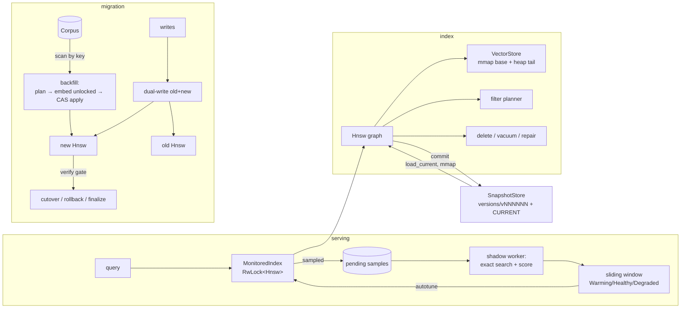

# Architecture

This document describes how `hnswops` is put together, the algorithms it
implements, and what each operation costs. Notation: `n` = slots in the index
(live + tombstoned), `d` = dimension, `M` = target degree, `L` = number of
layers (≈ `ln n / ln M`), `ef` = beam width.

## Module map

| module | responsibility |
|---|---|
| `hnsw/mod.rs` | graph nodes, insert (Alg. 1), layer search (Alg. 2), neighbor heuristic (Alg. 4), k-NN search (Alg. 5), exact scan |
| `hnsw/maintenance.rs` | delete (tombstone + local repair), vacuum (dangling-edge repair, compaction, connectivity repair), health report |
| `hnsw/filter.rs` | filter predicate language, selectivity estimate, cost-based planner |
| `distance.rs` | L2², cosine, inner product; auto-vectorizable kernels |
| `storage.rs` | vector store: read-only mmap base segment + heap tail; `vectors.bin` format |
| `visited.rs` | epoch-stamped visited sets, pooled for concurrent readers |
| `persist.rs` | index image = `manifest.json` + `vectors.bin` (mmap) + `graph.bin`; full validation on load |
| `snapshot.rs` | versioned store: atomic publish, `CURRENT` pointer, rollback, retention |
| `monitor.rs` | recall monitor: sampling, shadow evaluation, sliding window, status, autotune; `MonitoredIndex` |
| `embed.rs` | `Embedder` trait, feature-hashing embedder, `Corpus` trait + in-memory corpus |
| `migration.rs` | re-embedding state machine: dual-write, CAS backfill, verification gate, cutover, rollback |
| `dataset.rs`, `brute.rs`, `bench.rs` | `.fvecs`/`.ivecs` I/O and checksums, exact k-NN + recall, recall/QPS sweep + SVG |
| `main.rs`, `cli.rs`, `demo.rs` | the `hnswops` binary |



## The graph

Each node stores its caller key, a 64-bit tag mask, a tombstone flag and one
adjacency list per layer it belongs to (`links[l]`, `u32` internal ids). Node
levels are drawn from `floor(-ln U · mL)` with `mL = 1/ln M`, so a node reaches
layer `l` with probability `M^-l`; the generator is a seeded SplitMix64 whose
state is persisted, so a reloaded index keeps drawing the same levels as the
original would have (property-tested in `tests/prop_persist.rs`).

Layer 0 allows `2M` neighbors and upper layers `M`, as in the paper.

### Insert (Algorithm 1)

1. Greedy descent (beam 1) from the entry point through layers above the new
   node's level.
2. On each layer from `min(level, max_level)` down to 0: beam search with
   `efConstruction`, pick neighbors with the **diversity heuristic**
   (Algorithm 4: walk candidates nearest-first and keep `c` only if it is
   closer to the new node than to every neighbor already kept), link both
   ways, and shrink any neighbor list that overflows with the same heuristic.
3. If the new node is the highest so far it becomes the entry point.

Cost: `O(L·M·d)` for the descent plus `O(efC · M · d · log efC)` per layer on
layers ≤ level, i.e. **`O(efC · M · d · log n)` expected** per insert. The
heuristic is what keeps long-range edges between clusters; without it recall
on clustered data collapses.

Simplifications versus the paper: the heuristic runs without the optional
`extendCandidates` and `keepPrunedConnections` flags (the paper reports both
as only marginally useful for typical data). Upsert of an existing key is
"tombstone old + insert new", so readers never see a half-updated node.

### Search (Algorithms 2 and 5)

Greedy descent to layer 1, then a beam search of width `ef` on layer 0 with
two heaps (candidates min-heap, results max-heap). The layer search takes an
`accept` predicate: **every reached node is used for navigation, but only
accepted nodes enter the result set.** Tombstones and filter mismatches are
therefore still traversable, which is what keeps deletion and filtering from
disconnecting the graph. Cost: **`O(ef · M · d · log ef)`** distance work plus
`O(L·M·d)` for the descent; `SearchStats::distance_evals` reports the actual
count per query.

The visited set is an epoch-stamped `Vec<u32>` (bumping the epoch clears it in
O(1)) taken from a mutex-protected pool, so `&Hnsw` is `Sync` and any number of
threads can search concurrently.

### Distances

`L2` is squared Euclidean (monotone in true L2; no `sqrt`), `Cosine` is
`1 − ⟨a,b⟩` on vectors normalized at insert and query time, `InnerProduct` is
`−⟨a,b⟩`. The kernels use eight independent accumulators over `chunks_exact(8)`
so LLVM vectorizes them without `unsafe` intrinsics. The crate is
`#![deny(unsafe_code)]` except for the single `Mmap::map` call.

## Deletion: tombstones, local repair, vacuum

Removing a node from a proximity graph can disconnect the regions that were
reached only through it. `hnswops` uses three tiers:

| tier | when | what | cost |
|---|---|---|---|
| tombstone | `delete(key)` | mark deleted, drop from `key → id`; excluded from results immediately, still routable | O(1) |
| local repair | same call | for each layer and each live neighbor `u` that links back to the dead node: replace that edge by re-running the heuristic over `u`'s other neighbors ∪ the dead node's neighbors, back-filling to the old degree | `O(Σ_l deg_l² · d)` ≈ `O(M² · d)` |
| vacuum | `vacuum()` (operator-driven) | replace every remaining edge into a tombstone by the tombstone's live neighborhood (bounded walk through tombstone chains), compact ids and storage, then BFS each layer from the entry point and re-link orphans | `O(n · M · d)` + `O(orphans · efC · M · d)` |

Back-filling in local repair matters: the pure heuristic often returns fewer
than `M` edges, and repeating that over thousands of deletions erodes degrees
until regions fall off the graph. If the deleted node was the entry point, the
live node with the highest level (lowest id on ties) is elected.

`repair_connectivity()` exposes the last vacuum step on its own. It is needed
even without deletions: when the heuristic shrinks a full adjacency list it
can drop the last in-edge of some node, which then can never be returned by a
search (hnswlib has the same property). `HealthReport::unreachable_l0` counts
such nodes; the CLI integration test observed a handful after building the
fixture with M=12, efC=100.

Invariants checked by property tests (`tests/prop_delete.rs`, 256 random
operation sequences per run against a `BTreeMap` model): membership, stored
vectors and tags agree with the model; no deleted key is ever returned;
results are sorted and duplicate-free with correct distances; exact search
equals the model; after `vacuum` there are no tombstones, no dangling edges,
every live node is reachable, and a beam as wide as the index returns the
exact answer.

## Filtered search

A `Filter` is a boolean expression over the key and the tag mask
(`TagsAny`, `TagsAll`, `KeyRange`, `Not`, `And`, `Or`; CLI syntax
`tags_any=0x3,!key=0..10`). The planner:

1. estimates selectivity `s` from a deterministic strided sample of ≤ 512 nodes;
2. prices a **filtered graph walk** — beam widened to `ef/s` (clamped to
   `[ef, n]`), cost ≈ `widened · M` distance evaluations — against an **exact
   scan of the matches** — cost ≈ `s·n` distances + `n/32` for evaluating the
   predicate on every node;
3. always scans when `s < filter_brute_force_below` (default 5%) or when fewer
   than `ef` matches are expected.

The constant 32 (predicate vs distance cost) and the `M` evaluations per
expanded node are rough; the demo prints both estimates next to the measured
`distance_evals` so the model can be checked. On the 10k fixture this picks
the exact scan for a 12.5% filter (≈1.6k vs ≈8.2k estimated, 1,250 measured)
and the graph for a 98% filter (≈1.1k vs ≈10k, 464 measured). On larger
indexes the graph wins for progressively more selective filters, because the
scan cost grows with `n` and the graph cost does not.

## Storage and persistence

An index image is a directory:

| file | contents | loaded by |
|---|---|---|
| `manifest.json` | format version, `HnswConfig`, slot/live counts, entry point, RNG state, size + crc32 of each data file | read + parse |
| `vectors.bin` | 64-byte header (magic `HNSWVEC1`, version, dim, count, 40 zero bytes) + little-endian `f32` rows | **mmap** |
| `graph.bin` | magic, node count, then per node: key, tags, tombstone flag, level, per-layer `u16` degree + `u32` ids; trailing crc32 | read |

Load validates magic numbers, versions, reserved bytes, sizes, the graph
checksum (always) and the vector checksum (unless
`LoadOptions { verify_vectors: false }`, which keeps start-up O(1) in `n`), and
then every graph invariant (link targets in range and not self, link target
level ≥ layer, degree ≤ cap, unique live keys, entry point live, live count
matches the manifest). Any failure is `Error::Corrupt`, never a panic: the
property tests flip a random byte of either data file, or truncate it, and
assert exactly that. (That test found and fixed a real gap: header version and
reserved bytes were originally not validated.)

After load the `VectorStore` serves ids `< mapped_count` from the read-only
mapping and later inserts from a heap tail; the mapping is never written.
`vacuum` compacts into a plain heap store.

**Load cost:** `O(n · M)` to parse the graph plus O(1) for the vectors (pages
fault in on first touch), or `O(n · d)` with checksum verification.

## Versioned snapshots

```text
root/
  CURRENT                 "v000003\n"
  versions/
    v000001/  manifest.json  vectors.bin  graph.bin  snapshot.json
    v000002/  ...
```

`commit` writes the image into `versions/.tmp-vNNNNNN/`, fsyncs every file,
renames the directory into place, fsyncs `versions/`, then replaces `CURRENT`
by write-temp + fsync + rename + fsync of the root. A crash leaves either the
old or the new `CURRENT`; stray `.tmp-*` directories are removed by the next
`open`. Published versions are immutable, so readers may load concurrently
with a committing writer (`tests/snapshots.rs` runs three reader threads
against eleven commits and checks every load is a complete version).
`rollback(v)` fully verifies `v` before moving `CURRENT`; `prune(keep)` never
deletes the `CURRENT` version. One writer *process* per store is assumed; there
is no cross-process lock.

## Online recall monitoring

```text
serve ──▶ observe(): draw U < sample_rate? ──▶ push {query, k, ef, filter, served hits, generation}
                                               (bounded queue; overflow counted as dropped)
shadow worker ──▶ pop ──▶ exact = brute-force search (same filter)
                         served' = served hits, or a replay of the ANN query if the
                                   index generation changed since serving
                         recall  = |{h ∈ served'[..k] : dist(h) ≤ dist(exact[k-1]) + ε}| / |exact[..k]|
                ──▶ sliding window ──▶ mean, p10, min ──▶ status with hysteresis
```

* **Cost on the serving path:** one RNG draw; for sampled queries a clone of
  the query and the hits. Shadow cost is one exact scan, `O(n·d)`, per sample,
  so the CPU spent is `sample_rate · n·d` per served query — choose the rate
  from the CPU you are willing to spend (1% of queries on a 1M×128 index is
  ~1.3M flops per served query on average).
* **Distance-aware recall** counts a served hit as correct if it is no farther
  than the k-th exact neighbor, so equidistant ties are not misses.
* **Replay:** `MonitoredIndex` bumps a generation counter on every write. A
  sample served at an older generation is re-run against the current index
  before scoring, so writes between serving and evaluation cannot be mistaken
  for recall loss.
* **Status:** `Warming` until `min_samples`; `Degraded` when the window mean
  falls below `target_recall`; it returns to `Healthy` only above
  `target + recover_margin` (hysteresis prevents alert flapping). Each
  Healthy→Degraded transition counts an alert and logs a warning.
* **Autotune:** `suggest_ef` doubles `efSearch` when degraded and shrinks it by
  a quarter when the mean exceeds `target + slack`; `MonitoredIndex::autotune`
  applies it and resets the window so stale samples do not count.

## Zero-downtime re-embedding migration

State machine (`Phase`): `DualWrite → Backfilled → CutOver → (finalize)`, with
`CutOver → Backfilled` (rollback) and `abort` from any phase.

| phase | reads served by | writes go to |
|---|---|---|
| DualWrite | old index + old model | old and new |
| Backfilled | old | old and new |
| CutOver | **new** index + new model | old and new |
| finalized | new (returned to caller) | — |

**Backfill without the lost-update race.** The naive loop "read doc from the
corpus, embed, write into new index" can overwrite a newer dual-write with a
stale embedding when an update lands between the read and the write. The
migration keeps a per-key write sequence number, bumped by every dual-write or
dual-delete:

1. `plan_backfill` (under the lock): read the next page after the cursor and
   capture each key's current sequence number; advance the cursor.
2. `BackfillBatch::embed` (no lock): run the slow model.
3. `apply_backfill` (under the lock): for each row, if the key's sequence
   number changed since planning, skip it (a newer write won); if it was
   already non-zero at planning, skip it (the dual-write already put the latest
   version in the new index); otherwise insert.

Argument: every key present in the corpus at the end was either written by a
dual-write (so the new index has its latest version, and no later backfill row
can overwrite it because the sequence check fails), or never written during
the migration (so the backfill copies it exactly once, from a version that is
still current). Deleted keys are removed from both indexes by the dual-delete
and any in-flight backfill row for them fails the sequence check.
The unit tests in `migration.rs` exercise both race directions
deterministically (update and delete between plan and apply; write before
plan), and `concurrent_readers_never_fail_during_backfill` runs a reader
thread, a writer thread and `backfill_concurrently` together.

**Verification gate** (`verify`): coverage (every corpus key present in the
new index, none extra), the new index's own ANN-vs-exact recall@k on probe
queries ≥ threshold, and — informational — the overlap between old and new
top-k (a new model is expected to disagree; an overlap near zero suggests a
broken model). `cutover` refuses a failing report.

Locking: `backfill_concurrently` holds the write lock only for planning and
applying (`O(batch · insert)`), never while embedding; readers take the read
lock per query.

## Complexity summary

| operation | time | notes |
|---|---|---|
| insert / upsert | `O(efC · M · d · log n)` expected | upsert adds a delete |
| search | `O(ef · M · d · log ef + L · M · d)` | `distance_evals` reported per query |
| filtered search (graph) | `O((ef/s) · M · d)` | `s` = selectivity |
| filtered search (scan) | `O(n + s·n·d)` | exact |
| exact search | `O(n · d + n log k)` | used by monitor and as baseline |
| delete | `O(M² · d)` per layer of the node | tombstone + local repair |
| vacuum | `O(n · M · d)` + orphan repair | renumbers ids, rebuilds storage on heap |
| health | `O(n · M)` | BFS on layer 0 |
| save | `O(n · (d + M))` | sequential writes + fsync |
| load | `O(n · M)` graph + O(1) vectors (mmap) | `O(n · d)` with vector checksum |
| shadow sample | `O(n · d)` | per sampled query |
| migration | `O(n_docs · (embed + insert))` | backfill batches; dual-write doubles write cost |

Memory: vectors `4·n·d` bytes (mapped or heap); links at most `2M · 4` bytes
per node on layer 0 plus on average `M · 4 / (M − 1)` bytes for upper layers;
roughly 60 bytes of per-node overhead (`Vec` headers, key, tags, flag); and the
`key → id` hash map at roughly 16–24 bytes per live key.

## Concurrency model

* `Hnsw`: `&self` searches are concurrent (`Sync`); mutation needs `&mut self`.
* `MonitoredIndex`: `RwLock<Hnsw>` — many readers, one writer; the shadow
  worker takes the read lock per batch.
* `Migration`: callers wrap it in `RwLock`; `backfill_concurrently` shows the
  intended lock discipline.
* `SnapshotStore`: any number of reader processes, one writer process.
